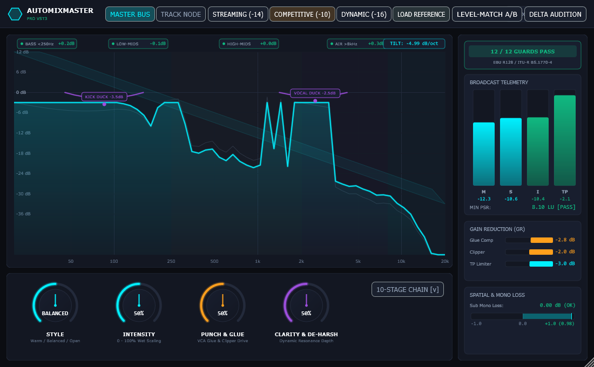

# AutoMixMaster

> **Next-Generation Intelligent Mixing & Mastering Audio Processor for FL Studio & Digital Audio Workstations**  
> *Engineered in modern C++20 with JUCE 8, RTNeural, and Differentiable Digital Signal Processing (DDSP).*

[](https://en.wikipedia.org/wiki/C%2B%2B20)
[](https://juce.com/)
[](https://www.steinberg.net/vst3/)
[](https://tech.ebu.ch/loudness)
[](#12-point-automated-verification-matrix)

---



---

## Overview

**AutoMixMaster** is a hybrid "Glass-Box" mixing and mastering system designed to bridge the gap between technical precision and musical context. Instead of relying on opaque, artifact-heavy black-box neural audio synthesis, AutoMixMaster extracts high-resolution psychoacoustic features and modulates deterministic, analytical C++20/JUCE DSP modules with complete human transparency and real-time parameter control.

Operating in dual modes—**Master Bus Brain** and **Track Mix Node**—it provides an integrated end-to-end production workflow:
1. **At the Track Level:** Automatic `-18.0 dBFS RMS` analog gain staging, 11-class hybrid stem classification, transient-preserving compression, sibilance control, and lock-free cross-adaptive unmasking (e.g. Kick-to-Bass dynamic ducking and Vocal-to-Music presence clearing).
2. **At the Master Bus Level:** A 10-stage auto-gain-compensated mastering chain governed by an automated **12-Point Closed-Loop Optimizer** that converges on target loudness, maintains dynamic punch (PSR $\ge 8.0\text{ LU}$), enforces True Peak ceilings, conforms to empirical $-4.5\text{ dB/octave}$ tonal corridors, and guarantees mono compatibility.

---

## Key Features

### 1. Dual Operating Topology

AutoMixMaster operates in two distinct modes via an atomic runtime toggle:

- **`MASTER BUS BRAIN` Mode:** Placed on the DAW master insert. Evaluates global integrated loudness, True Peak, dynamic margin (PSR), 4-band spectral tilt, and spatial mono-sum loss across the full stereo mix. Houses the full 10-stage mastering chain, 3 streaming target presets, and reference track matching.
- **`TRACK MIX NODE` Mode:** Placed on individual mixer inserts (Kick, Snare, 808, Bass, Lead Vocal, Pads, etc.). Automatically normalizes incoming audio to `-18.0 dBFS RMS`, identifies the stem category, applies source-tailored subtractive EQ, de-essing, and dynamics, and broadcasts real-time telemetry to the Master Brain via a zero-allocation, lock-free Single-Producer Single-Consumer (`InterPluginBus`) memory registry.

### 2. Deterministic 10-Stage Mastering Chain

Every stage is auto-gain-compensated and features transparent DSP algorithms:

| Stage | Name | Algorithm / Specifications |
| :---: | :--- | :--- |
| **1** | **Input Trim & Subsonic Guard** | Evaluates incoming PLR and LUFS. Trims unmastered mixes to $-6\text{ dBFS}$ peak (or $-18\text{ dBFS RMS}$ if pre-limited). Strips subsonic rumble via a 20 Hz 3rd-order high-pass filter. |
| **2** | **Corrective Linear-Phase EQ** | Surgical narrow notches (hard-capped at $\le 3.0\text{ dB}$ cut) targeting stationary room/mic resonant spikes without altering overall mix tonality. |
| **3** | **Mix-Bus Glue Compressor** | Decoupled one-pole ballistic level detector (Giannoulis et al.) with internal K-weighting sidechain filter, 1.5:1–2:1 ratio, slow attack (15–30 ms), auto-release, and soft knee targeting $1.0\text{ to }2.0\text{ dB}$ of transparent glue. |
| **4** | **Low-Band Crest & Dynamic EQ** | Multiband crest compressor below 250 Hz preventing sub-bass transients from pumping the master limiter, coupled with dynamic EQ targeting 2–5 kHz harshness. |
| **5** | **Mid/Side Crossover & Width** | 120 Hz Linkwitz-Riley 4th-order crossover. Automatically collapses Side channel to 0% width below 120 Hz if sub mono loss exceeds $1.0\text{ dB}$ (or sub correlation $< +0.3$). Allows subtle high-shelf Side boost, immediately rolling back if correlation drops below $0.0$. |
| **6** | **Harmonic Saturation** | Mid/High band-limited even-order (tube) and odd-order (tape) polynomial waveshaping for density, gain-compensated to match dry loudness. |
| **7** | **Tonal-Balance Target EQ** | Broad shelves and wide bells (hard-capped at $\pm 3.0\text{ dB}$ on master) dynamically fitting the mix into the empirical $-4.5\text{ dB/octave}$ commercial target envelope. |
| **8** | **Dynamic Resonance Suppressor** | Continuous full-spectrum FFT spectral tracking with level-independent soft-threshold suppression (200 Hz–12 kHz, max notch depth 6–9 dB). |
| **9** | **Oversampled Soft Clipper** | Shaves $1.0\text{ to }2.0\text{ dB}$ off high-velocity transient peaks with 4x polyphase oversampling to prevent limiter pumping and inter-sample distortion. |
| **10**| **Lookahead True-Peak Limiter** | 4x polyphase FIR True-Peak limiter (128-tap Kaiser window, $\beta = 8.5$, $\le 0.1\text{ dB}$ inter-sample ripple) driving the signal to exact delivery targets with TPDF dither. |

### 3. 12-Point Automated Render Verification Matrix

The closed-loop optimizer analyzes the mix against 12 industry guards. If any metric falls out of compliance, the engine executes targeted first-pass DSP adjustments:

| # | Guard Check | Target Requirement | Automated Closed-Loop DSP Fallback |
| :-: | :--- | :--- | :--- |
| **1** | **Input Pre-Limit Guard** | Peaks $\approx -6\text{ dBFS}$; $\text{PLR} \ge 11\text{ dB}$ | Trims input to $-18\text{ dBFS RMS}$; bypasses maximizer stages |
| **2** | **Integrated Loudness** | Preset Target $\pm 0.5\text{ LU}$ | Modulates limiter threshold/drive iteratively |
| **3** | **True Peak Ceiling** | $\le -1.0\text{ dBTP}$ ($-2.0$ Competitive) | Clamps ceiling via 128-tap Kaiser FIR filter |
| **4** | **Minimum PSR** | $\ge 8.0\text{ LU}$ ($\ge 10.0$ Streaming) | Offloads limiter reduction to Stage 9 clipper and Stage 3 glue |
| **5** | **Limiter Gain Reduction** | Nominal $1.0\text{–}4.0\text{ dB}$ ($\le 6.0\text{ dB}$) | Shifts load upstream to multiband crest and mix glue |
| **6** | **4-Band Tonal Balance** | $-4.5\text{ dB/oct}$ corridor ($\pm 1.5\text{ dB}$) | Applies broad corrective shelves (<250 Hz, 250–2k, 2k–8k, >8k) |
| **7** | **Low-Band Crest Factor** | Stable dynamic envelope $<250\text{ Hz}$ | Engages Stage 4 low-band crest compressor |
| **8** | **Dynamic Resonance** | Smooth 2–6 kHz presence | Activates level-independent spectral de-resonator |
| **9** | **Multi-Band Correlation** | $> 0.0$ across all 4 bands | Rolls back Side widening; executes $0^\circ\text{–}360^\circ$ phase sweep |
| **10**| **Sub-Band Mono-Sum Loss** | $< 1.0\text{ dB}$ loss below 120 Hz | Collapses low-end width to 100% mono below 120 Hz |
| **11**| **Lead Vocal Level Anchor** | $-3.0\text{ LU} \pm 1.5\text{ LU}$ rel. to mix | Applies 2–3 dB dynamic EQ ducking on clashing instruments |
| **12**| **Spatial / Reverb Return** | Clean separation; mono sub | High-passes auxiliary sends at 250 Hz; trims returns |

### 4. Cross-Adaptive Unmasking & Phase Optimization

- **Kick-to-Bass Dynamic Unmasking ($60\text{–}150\text{ Hz}$):** When a `Bass` or `808` node detects a kick trigger (via DAW sidechain input or inter-plugin bus), it carves out a fast $2.0\text{ to }4.0\text{ dB}$ dynamic dip while leaving mid/upper bass harmonics intact.
- **Vocal-to-Music Dynamic Unmasking ($1\text{–}4\text{ kHz}$):** Carves out $2.0\text{ to }3.0\text{ dB}$ across clashing mid instruments (synths, guitars, pads) during vocal phrases to maintain vocal intelligibility without thinning the mix.
- **16-Step Sub Phase Alignment:** Automatically sweeps low-end phase angles ($0^\circ\text{–}360^\circ$) between colliding sub layers to resolve phase cancellation, delivering $+2.0\text{ to }+4.0\text{ dB}$ of constructive sub reinforcement.

### 5. Level-Matched Monitoring & Auditioning

- **`LEVEL-MATCH A/B`:** Automatically scales dry input loudness by the inverse of net LUFS gain, allowing the engineer to audition tonal improvements without loudness deception.
- **`DELTA AUDITION`:** Isolates the mathematical difference `(Output - LevelMatchedInput)` so you can clearly hear only the harmonics, ducking cuts, and transients AutoMixMaster is modifying.

---

## GUI Architecture

The user interface is hardware-accelerated, high-DPI scalable ($1100 \times 680$ default), and features a modern dark aesthetic inspired by FabFilter and oeksound:

1. **Top Transport & Telemetry Bar:**
   - Operating mode toggle (`MASTER BUS` vs `TRACK NODE`).
   - 11-stem classification dropdown (*Auto-Detect, Lead Vocal, Backing Vocal, Kick, Snare, 808/Sub, Bass, Hi-Hats, Pads/Keys, Lead Synth, Drum Bus*).
   - Target presets: `STREAMING (-14)`, `COMPETITIVE (-10)`, `DYNAMIC (-16)`, and `LOAD REFERENCE`.
   - Monitoring buttons: `LEVEL-MATCH A/B` and `DELTA AUDITION`.
   - Real-time sidechain detector badge (`AUX SC: ACTIVE`).

2. **Center 60 FPS Visual Analyzer Canvas:**
   - 64-bin FFT spectrum visualizer with smooth visual ballistics (fast attack 0.70, release 0.20) and neon cyan gradient under-fill.
   - Commercial $-4.5\text{ dB/octave}$ target corridor with live 4-band compliance badges (`BASS <250Hz`, `LOW-MIDS`, `HIGH-MIDS`, `AIR >8kHz`, and overall `TILT dB/oct`).
   - Electric violet dynamic unmasking nodes and tooltips (`KICK DUCK -3.5dB` at 85 Hz and `VOCAL DUCK -2.5dB` at 2.5 kHz).

3. **Bottom Macro Bar & Chain Drawer:**
   - 4 rotary macro knobs with circular neon arc meters:
     - **`STYLE`:** Switches between Warm, Balanced, and Open tonal weights.
     - **`INTENSITY`:** $0\%\text{–}100\%$ wet/dry chain scaling.
     - **`PUNCH & GLUE`:** VCA glue compression drive and soft-clipper shaving.
     - **`CLARITY & DE-HARSH`:** Dynamic resonance suppression depth.
   - Expandable `10-STAGE CHAIN [v]` drawer revealing the operational status of all ten stages.

4. **Right Telemetry Dock:**
   - **`12 / 12 GUARDS PASS`** emerald compliance badge.
   - Vertical broadcast meters for Momentary (`M`), Short-Term (`S`), Integrated (`I`), True Peak (`TP`), and minimum PSR dynamic margin (`MIN PSR: 8.10 LU [PASS]`).
   - Inverted gain reduction meters for Glue Compressor, Clipper, and Lookahead Limiter.
   - Sub Mono Loss ($<120\text{ Hz}$) readout and 4-band stereo correlation vector bar.

---

## Presets & Target Standards

| Preset | Target Integrated | True Peak Ceiling | Minimum PSR | Target Application |
| :--- | :---: | :---: | :---: | :--- |
| **`Streaming-Safe`** | $-14.0\text{ LUFS} \pm 0.5$ | $\le -1.00\text{ dBTP}$ | $\ge 10.0\text{ LU}$ | Spotify, Apple Music, YouTube, Tidal, Amazon Music |
| **`Competitive`** | $-10.0\text{ LUFS} \pm 0.5$ | $\le -2.00\text{ dBTP}$ | $\ge 8.0\text{ LU}$ | Club, Trap, EDM, Hot Pop, Beatport, CD masters |
| **`Dynamic`** | $-16.0\text{ LUFS} \pm 0.5$ | $\le -1.00\text{ dBTP}$ | $\ge 12.0\text{ LU}$ | Jazz, Acoustic, Classical, Film Score, Ambient |

---

## Installation & Setup in FL Studio

### 1. Copy VST3 Plugin
Copy the compiled `AutoMixMaster.vst3` bundle to your standard VST3 directory:
- **Windows:** `C:\Program Files\Common Files\VST3\`
- **macOS:** `/Library/Audio/Plug-Ins/VST3/`

### 2. Rescan Plugins in FL Studio
1. Open FL Studio and navigate to **Options** $\rightarrow$ **Manage plugins**.
2. Click **Find installed plugins**.
3. Locate `AutoMixMaster` and mark it as a favorite.

### 3. Workflow Configuration
- **On Individual Tracks (Mix Node):**
  1. Insert `AutoMixMaster` on your Kick, Bass, and Vocal mixer inserts.
  2. Switch the mode to `TRACK NODE` (or let Auto-Detect identify the stem class).
  3. The plugin will immediately calibrate the stem to $-18.0\text{ dBFS RMS}$ analog headroom.
- **Sidechain Routing in FL Studio:**
  1. In the FL Studio mixer, select your **Kick** track, right-click the send arrow on your **Bass** track, and choose **Sidechain to this track**.
  2. Open the Bass `AutoMixMaster` instance, click the **Gear (Wrapper Settings)** icon $\rightarrow$ **Processing** tab.
  3. Under **Connections**, assign the sidechained Kick input to **Aux Input (Bus 1)**.
  4. The top bar will display `● AUX SC: ACTIVE`, and the 60–150 Hz Kick-to-Bass unmasking filter will automatically engage.
- **On the Master Bus:**
  1. Insert `AutoMixMaster` on Mixer Insert 0 (**Master**).
  2. Ensure the mode is set to `MASTER BUS BRAIN`.
  3. Select your desired delivery preset (`STREAMING`, `COMPETITIVE`, or `DYNAMIC`).

---

## Headless CLI Verification Tool

AutoMixMaster includes a standalone command-line verification engine (`AutoMixMaster_CLI`) for automated batch mastering, unit verification, and CI/CD pipelines.

### Usage Examples

```powershell
# 1. Master a single audio file to competitive standard (-10 LUFS):
./AutoMixMaster_CLI unmastered_mix.wav -10.0 --preset competitive

# 2. Master with custom target loudness and export to specific file:
./AutoMixMaster_CLI song.wav -14.0 --preset streaming-safe song_mastered.wav

# 3. Run full multitrack collision test (stems, phase, unmasking & GUI render):
./AutoMixMaster_CLI --multitrack-test --preset competitive
```

### CLI Output & Verification Report
When running `--multitrack-test`, the CLI automatically:
- Synthesizes 4 colliding stems (Kick, 808 Bass with $180^\circ$ phase cancellation, buried Vocal, masking Synth Pad).
- Performs automated 16-step phase optimization and cross-adaptive ducking.
- Executes the 10-stage master chain in closed-loop until all 12 guards pass.
- Cross-verifies telemetry against `ffmpeg -af ebur128=peak=true`.
- Generates a markdown verification report (`multitrack_verification_report.md`) and exports a live GUI snapshot (`gui_preview.png`).

---

## Building from Source

### Prerequisites
- **Compiler:** Clang 18+ (LLVM-MinGW on Windows) or MSVC 2022 / GCC 13+ (supporting C++20).
- **Build System:** CMake 3.22+ and Ninja.
- **JUCE 8:** Managed automatically via CMake `FetchContent`.
- **RTNeural:** Managed automatically via CMake `FetchContent`.
- **FFmpeg:** (Optional) On system `PATH` for external EBU R128 cross-checks.

### Incremental Build Instructions (Windows PowerShell)

```powershell
# Clone the repository
git clone https://github.com/Arpit-26/AutoMixMaster.git
cd AutoMixMaster

# Configure build tree
cmake -B build -G Ninja -DCMAKE_BUILD_TYPE=Release -DBUILD_VST3_PLUGIN=ON

# Compile all targets (VST3, Standalone, and CLI)
cmake --build build --config Release
```

### Build Artifact Locations
- **VST3 Plugin Bundle:** `build/AutoMixMaster_VST3_artefacts/Release/VST3/AutoMixMaster.vst3/`
- **Standalone Application:** `build/AutoMixMaster_VST3_artefacts/Release/Standalone/AutoMixMaster.exe`
- **CLI Runner:** `build/AutoMixMaster_CLI_artefacts/Release/AutoMixMaster_CLI.exe`

---

## Project Structure

```
AutoMixMaster/
├── CMakeLists.txt                  # JUCE 8 & C++20 multi-target build configuration
├── gui_preview.png                 # High-resolution vector GUI snapshot
├── docs/
│   └── architecture_spec.md       # Complete 25-page mathematical & psychoacoustic specification
├── src/
│   ├── PluginProcessor.h/cpp      # Main JUCE AudioProcessor (zero heap allocation audio loop)
│   ├── dsp/                       # Core DSP algorithms
│   │   ├── LoudnessMeter.h/cpp    # ITU-R BS.1770-4 K-weighting, gated LUFS & LRA
│   │   ├── TruePeakMeter.h/cpp    # 4x Kaiser 128-tap polyphase inter-sample peak detector
│   │   ├── TruePeakLimiter.h/cpp  # Lookahead brickwall limiter with TPDF dither
│   │   ├── SpectralAnalyzer.h/cpp # 64-bin FFT engine, -4.5 dB/oct tilt, crest & correlation
│   │   ├── SpatialAnalyzer.h/cpp  # 4-band Linkwitz-Riley phase correlation & mono-loss
│   │   ├── MasterChain.h/cpp      # 10-stage mastering chain & 12-point closed-loop optimizer
│   │   └── mix/                   # Per-track mix engine
│   │       ├── InterPluginBus.h/cpp       # Lock-free SPSC inter-plugin shared memory registry
│   │       ├── StemClassifier.h/cpp       # 11-class hybrid name & spectral feature classifier
│   │       └── SourceChainProcessor.h/cpp # 11 source-tailored chains, de-essing, dynamic EQ
│   ├── gui/                       # 60 FPS hardware-accelerated vector UI
│   │   ├── GuiColours.h           # Obsidian palette and typography tokens
│   │   ├── TopBarComponent.h      # Mode switcher, presets, level-matched A/B & delta
│   │   ├── SpectrumCanvasComponent.h # 64-bin FFT curve, tonal corridor & dynamic notches
│   │   ├── MacroBarComponent.h    # 4 rotary dials with arc meters & 10-stage drawer
│   │   ├── TelemetryDockComponent.h  # EBU R128 vertical meters, GR meters & 12-guard badge
│   │   └── PluginEditor.h/cpp     # Resizable top-level AudioProcessorEditor container
│   └── cli/
│       ├── main.cpp               # Headless CLI verification runner
│       └── TestSignalGenerator.h  # Synthetic multitrack signal generator
```

---

## Standards Compliance & References

1. **ITU-R BS.1770-4:** *Algorithms to measure audio programme loudness and true-peak audio level.*
2. **EBU R128 / EBU Tech 3342:** *Loudness Normalisation and Permitted Maximum Level of Audio Signals; Loudness Range (LRA).*
3. **Giannoulis, D., Massberg, M., & Reiss, J. D. (2012):** *Digital Dynamic Range Compressor Design—A Tutorial and Analysis.* Journal of the Audio Engineering Society.
4. **SAFE Project (Stables et al.):** *Empirical evaluation of 178 professional mixing sessions across 47 audio engineers.*
5. **Kaiser Window FIR Resampling:** *128-tap polyphase 4x oversampling True-Peak interpolation with $\beta = 8.5$.*

---

## License

This project is licensed under the Apache 2.0 License. See the [LICENSE](LICENSE) file for details.
